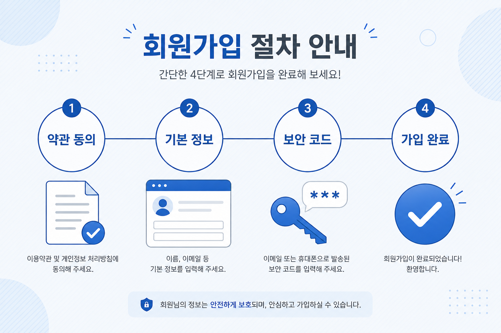

# 0. 소개와 목적

## 이 사이트는 무엇인가요?

관심 주제마다 **갤러리(게시판)** 가 있고, 사람들은 그 안에서 글을 읽고 씁니다.  
디시인사이드 스타일의 커뮤니티를 쓰는 방법을 안내합니다.

초보 이용자가 처음 하는 일은 보통 다음 세 가지입니다.

1. **둘러보기** — 메인·마이너·미니·인물 갤러리 메뉴로 들어가 글 읽기  
2. **가입하기** — 고정닉(회원)을 만들어 로그인하기  
3. **만들기** — 나만의 갤러리를 신청하기 (종류마다 심사·제한이 다를 수 있음)

## 이 가이드의 목적

| 목적 | 설명 |
|------|------|
| **헷갈림 줄이기** | 메인/마이너/미니/인물이 **이용자 입장**에서 무엇이 다른지 |
| **따라 하기** | 가입 · 검색 · 개설을 화면 순서대로 |
| **실패 이유 알기** | 이름·주소·카테고리가 잘못되면 왜 안 되는지 |
| **결과 이해하기** | 만들기 후 바로 열리지 않을 수 있음 · 승인/반려 |

## 이 가이드가 다루지 않는 것

- 프로그램 구조, API, 서버 설정 같은 **개발 내용**  
  → 개발자는 [user-guide-dev](../user-guide-dev/README.md) 를 보세요.

> **한 줄 요약:** 코딩을 모르는 이용자가 사이트를 안전하게 쓰도록 돕는 **사용 설명서**입니다.

## 다음에 읽을 글

→ [1. 화면 둘러보기](./01-화면-둘러보기.md)
