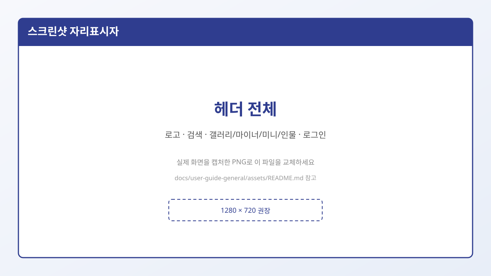
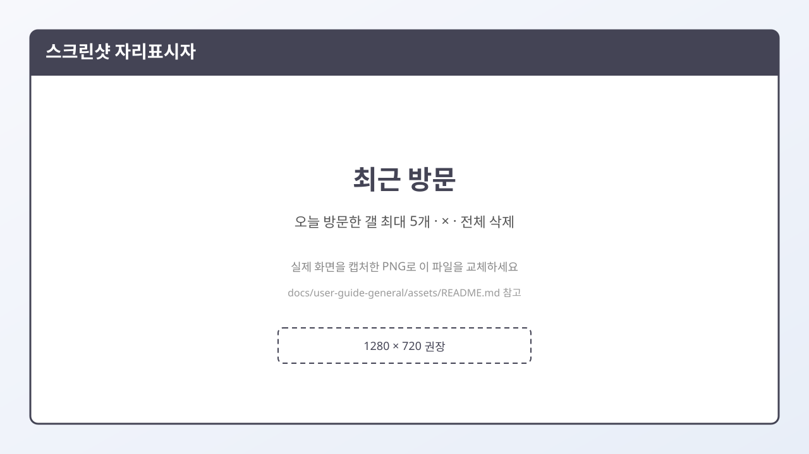

# 1. 화면 둘러보기

처음 들어오면 위쪽에 **헤더(공통 메뉴)** 가 보입니다. 거의 모든 페이지에서 같은 헤더를 사용합니다.

> 위 그림은 **자리표시자**입니다. 실제 화면을 찍은 뒤 같은 파일 이름으로 `01-header-overview.png`를 넣으면 문서가 실제 스크린샷으로 바뀝니다.  
> 촬영 방법: [assets/README.md](./assets/README.md)

## 헤더에서 보이는 것들

| 항목 | 하는 일 |
|------|---------|
| **로고** | 사이트 홈(`/www`)으로 이동 |
| **검색창** | 「갤러리 & 통합검색」 — 입력 후 검색하면 `/search/q`로 이동 |
| **갤러리 / 마이너갤 / 미니갤 / 인물갤** | 각 종류별 **목록(인덱스)** 페이지 |
| **갤로그** | 개인 공간 관련 메뉴 |
| **로그인 / 회원가입** | 비로그인일 때 |
| **닉네임 메뉴 / 로그아웃** | 로그인했을 때 (MY갤로그, 고정닉정보, 즐겨찾기 등) |
| **최근 방문** | 오늘 들어갔던 갤러리(최대 5개) 바로가기 |

## 최근 방문이란?

갤러리 게시판(목록·글보기·글쓰기)에 들어가면, 헤더의 **최근 방문**에 자동으로 쌓입니다.

- **하루 기준**으로 초기화됩니다. (날짜가 바뀌면 어제 목록은 비움)
- 최대 **5개**까지 표시됩니다.
- 항목 옆 **×** 로 하나만 지우거나, **전체**로 모두 지울 수 있습니다.

## 네 가지 갤러리 메뉴는 어디로 가나요?

| 메뉴 이름 | 주소 | 느낌 (초보용) |
|-----------|------|----------------|
| 갤러리 | `/gall` | 메인(공식에 가까운) 갤러리 광장 |
| 마이너갤 | `/gall/m` | 누구나 주제 갤을 열어보는 광장 |
| 미니갤 | `/gall/n` | 더 작은·비공개도 가능한 갤 광장 |
| 인물갤 | `/gall/p` | 사람(인물) 주제를 모은 광장 |

종류별 차이는 → [4. 갤러리 종류 비교](./04-갤러리-종류-비교.md)

## 다음에 읽을 글

→ [2. 회원가입](./02-회원가입.md)
