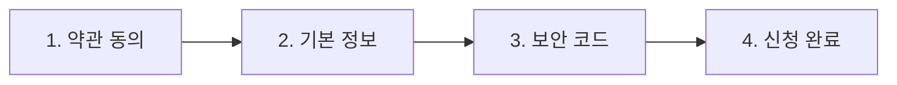
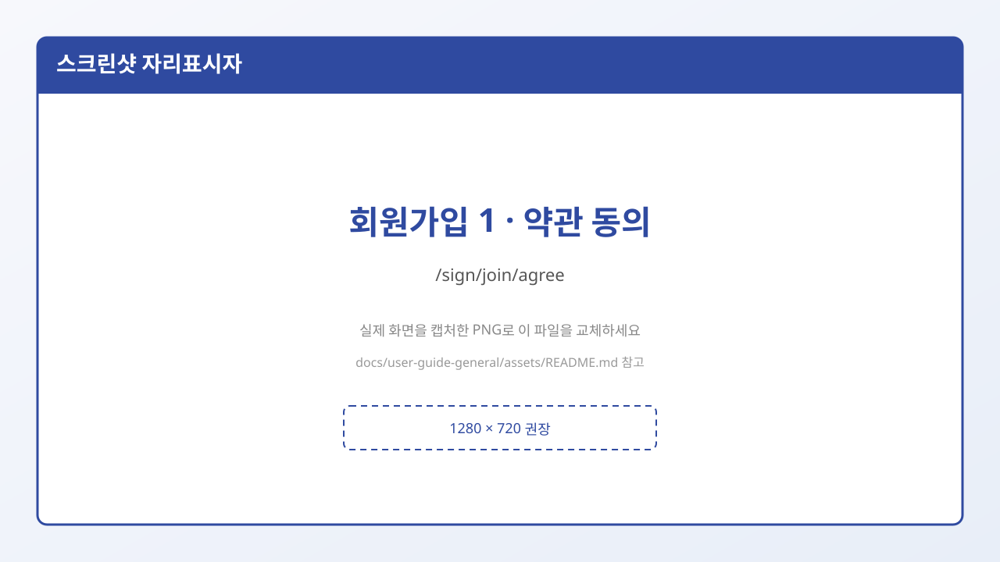
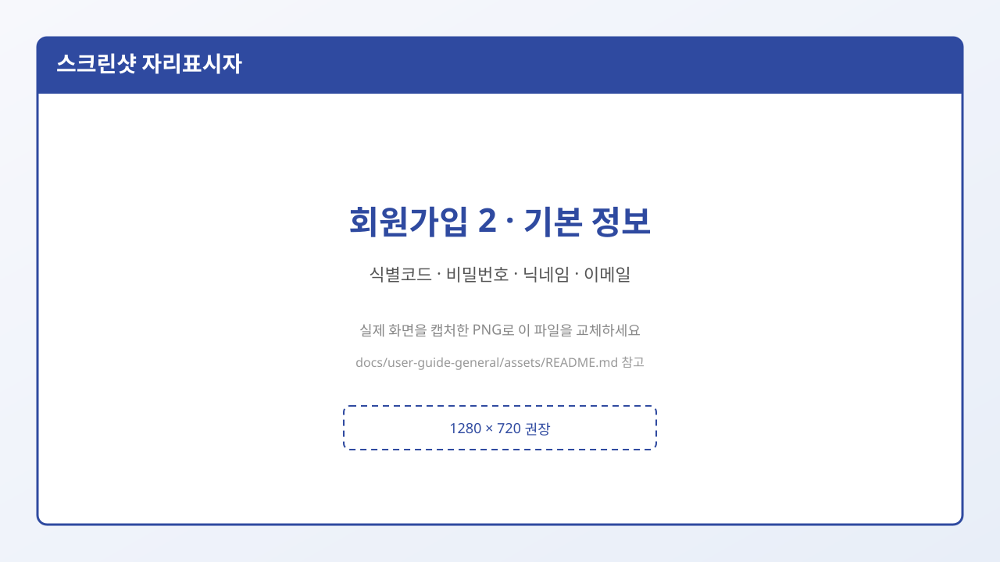
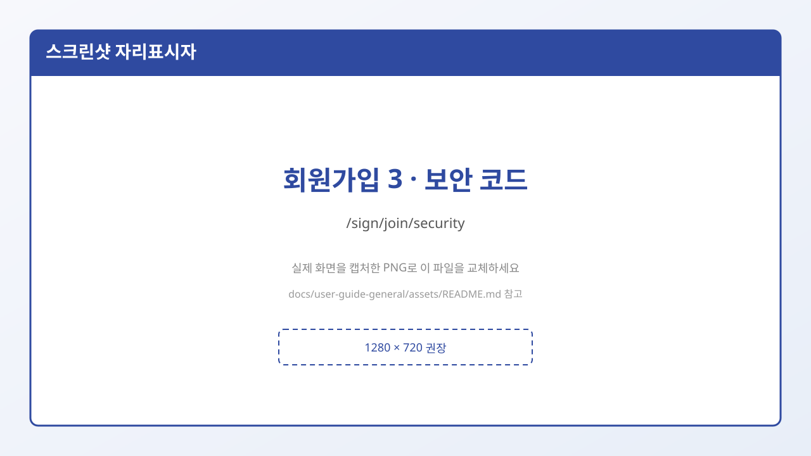
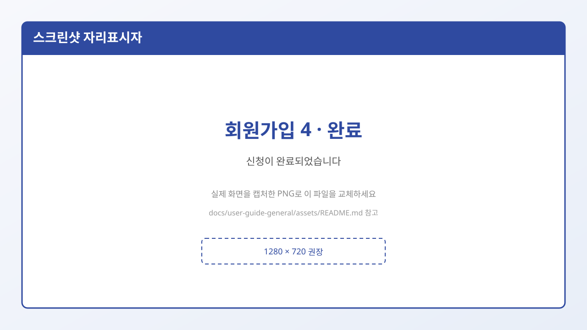

# 2. 회원가입 (고정닉 신청)

디시인사이드 계열 사이트에서는 보통 회원 닉을 **고정닉**이라고 부릅니다.  
가입은 아래 **4단계**로 진행됩니다.

## 시작 위치

1. 헤더에서 **회원가입** 클릭  
2. 또는 주소로 이동: `/sign/register` → 곧 `/sign/join/agree`로 이어집니다.

---

## 1단계 — 약관 동의 (`/sign/join/agree`)

- 대상: **만 14세 이상** 고정닉 신청 (화면 안내 기준)
- 필수 체크
  - [필수] 디시인사이드 이용약관
  - [필수] 개인정보 수집 및 이용
- **전체 동의하기**를 누르면 필수 항목을 한번에 선택할 수 있습니다.
- **다음**을 누르면 기본 정보 입력으로 이동합니다.

> **주의:** 약관에 동의하지 않으면 다음 단계로 갈 수 없습니다.

---

## 2단계 — 기본 정보 입력 (`/sign/join/info`)

| 항목 | 필수? | 규칙 (초보용) | 예시 |
|------|-------|----------------|------|
| **식별 코드** | 필수 | 로그인 ID. **한글 불가**. 영문/숫자로 시작, 영문·숫자·`-`·`_` , **3~20자** | `myid01` (O) / `샘플코드` (X) |
| **비밀번호** | 필수 | **8자 이상** | `password1` |
| **닉네임** | 필수 | 화면에 보이는 이름. **2~20자** | `초보이용자` |
| **이메일** | 선택 | 적으면 이메일 형식이어야 함 | `a@b.com` |

### 자주 나는 실수

| 증상 | 원인 | 해결 |
|------|------|------|
| 「식별 코드를 입력해 주세요」가 뜨는데 한글은 이미 입력함 | 한글 식별 코드는 **가입이 거절되거나 입력 오류로** 처리됨 | 영문/숫자 ID로 다시 입력 |
| 비밀번호 오류 | 8자 미만 | 8자 이상으로 |
| 닉네임 오류 | 너무 짧거나 김 | 2~20자로 |

입력이 끝나면 **다음** → 보안 코드 단계로 갑니다.

---

## 3단계 — 보안 코드 발급 (`/sign/join/security`)

- 화면에 **보안 코드** 안내가 나옵니다.
- **신청 완료**를 누르면 실제 가입(등록)이 진행되고, 성공 시 자동 로그인 후 완료 페이지로 이동합니다.

> 보안 코드는 “내가 사람인지 확인하는 절차”의 일부로 이해하면 됩니다.  
> (자동 가입 방지용 캡차는 현재 프론트에서 제거된 상태입니다.)

---

## 4단계 — 완료 (`/sign/join/done`)

- 「신청이 완료되었습니다.」 류의 안내가 보입니다.
- 이후 **로그인** 상태라면 갤러리를 둘러보거나, 갤러리 만들기를 시도할 수 있습니다.

---

## 따라하기 동영상

- 스크립트: [assets/videos/01-signup-login.md](./assets/videos/01-signup-login.md)
- 플레이스홀더: [assets/videos/01-signup-login.placeholder.html](./assets/videos/01-signup-login.placeholder.html)

## 다음에 읽을 글

→ [3. 로그인](./03-로그인.md)
