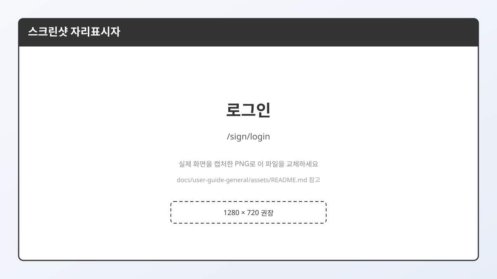

# 3. 로그인

주소: `/sign/login`

## 입력 항목

| 항목 | 설명 |
|------|------|
| **식별 코드** | 가입할 때 만든 ID (영문/숫자 계열) |
| **비밀번호** | 가입 시 비밀번호 |
| **코드 저장** | 다음에 식별 코드를 기억해 두는 옵션 |
| **보안접속** | 보안 연결 관련 옵션(화면 제공 시) |

로그인에 성공하면 원래 보려던 페이지로 돌아갈 수 있습니다.  
(`?s_url=` 로 돌아올 주소가 붙어 있는 경우가 많습니다. 예: 글쓰기 중 로그인이 필요할 때)

## 로그인이 필요한 기능

- 새 갤러리 만들기 (`/gall/create`, `/gall/m/create`, `/gall/n/create`, `/gall/p/create`)
- 일부 글쓰기·운영 기능
- 헤더의 회원 전용 메뉴 (MY갤로그, 고정닉정보 등)

## 로그아웃

헤더의 닉네임 영역에서 **로그아웃**을 선택합니다.

## 다음에 읽을 글

→ [4. 갤러리 종류 비교](./04-갤러리-종류-비교.md)
