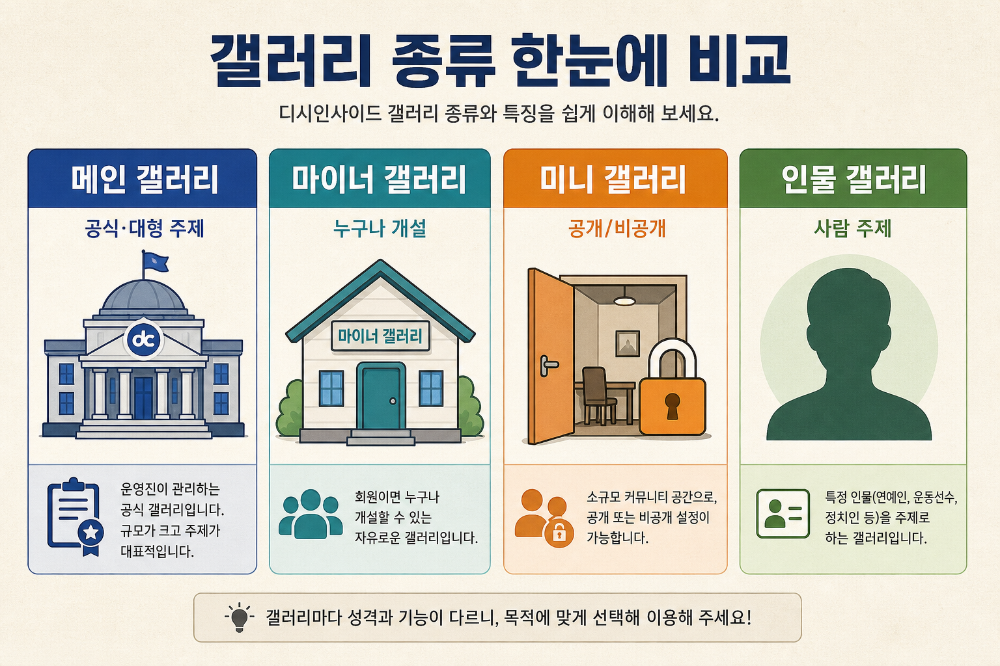
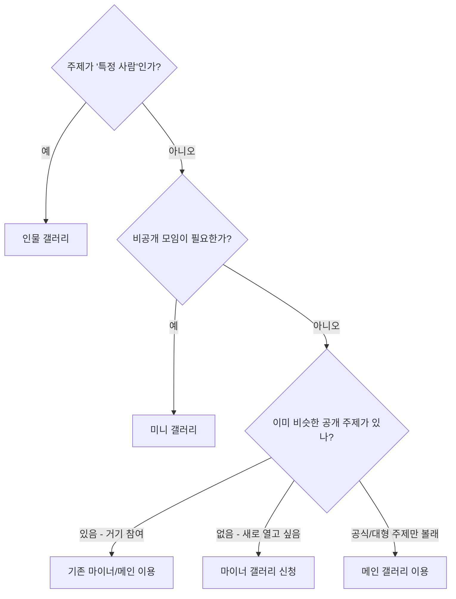

# 4. 갤러리 종류 비교 (초보자용)

기술적인 DB 타입 이야기가 아니라, **“나는 어디에 글을 읽고, 어떤 갤을 만들어야 하지?”** 관점으로 정리합니다.

---

## 한눈에 보기

| 구분 | 메인 갤러리 | 마이너 갤러리 | 미니 갤러리 | 인물 갤러리 |
|------|-------------|---------------|-------------|-------------|
| **메뉴 이름** | 갤러리 | 마이너갤 | 미니갤 | 인물갤 |
| **목록 주소** | `/gall` | `/gall/m` | `/gall/n` | `/gall/p` |
| **이런 사람에게** | 큰 주제·공식에 가까운 공간에서 놀고 싶을 때 | 새 주제를 **비교적 쉽게** 열고 싶을 때 | 작은 모임·**비공개**도 필요할 때 | **특정 인물**을 주제로 할 때 |
| **개설 난이도(체감)** | 높음 (심사 강조) | 중간 (중복 주제 주의) | 낮~중 (공개/비공개 선택) | 중간 (동일 인물 제한) |
| **공개/비공개** | 보통 공개 성격 | 보통 공개 성격 | **공개 또는 비공개** 선택 가능 | 보통 공개 성격 |
| **메인으로 승격?** | 이미 메인 | 가능하다고 안내됨 (심사) | **승격 대상 아님** | 승격 관련 안내·동의 있음 |
| **중복 주제** | 심사에서 걸러질 수 있음 | **같은 주제 개설 어려움** | 중복 주제 **가능**하다고 안내 | 같은 인물·유사 주제 제한 |

---

## 메인 갤러리

**느낌:** 광장 한가운데에 있는 **큰 공식 게시판**에 가깝습니다.

- 많은 사람이 이미 알고 있는 주제가 많습니다.
- 새로 “메인 갤러리 만들기”를 신청하면, 화면에 **심사 후 개설이 확정**된다는 안내가 강하게 나옵니다.
- 이름·주제가 기준에 안 맞으면 **반려**될 수 있다고 안내합니다.

**언제 쓰나?**  
이미 있는 메인 갤에서 글을 읽고 쓸 때.  
“내가 새 메인을 연다”는 초보에게는 드물고, 보통은 **기존 메인 갤을 방문**하는 경우가 많습니다.

목록: `/gall`  
게시판 예: `/gall/board/lists/?id=갤주소`

---

## 마이너 갤러리

**느낌:** “관심 있으면 **누구나 주제를 열어볼 수 있는** 갤러리”입니다.

인덱스 문구 요지: **누구나 개설할 수 있는 마이너 갤러리를 만들어보세요.**

- 만들기: `/gall/m/create` (로그인 필요)
- **주의(초보가 가장 많이 헷갈림):**  
  - **같은(중복) 주제**의 마이너가 이미 있으면 신청이 **반려**될 수 있습니다.  
  - 그래서 신청 전에 **검색으로 비슷한 갤이 있는지** 확인하라고 안내합니다.  
  - 중복이 걱정되면 **미니 갤러리**를 안내하기도 합니다. (미니는 중복 주제 개설이 가능하다고 안내)
- 영화·드라마 등 일부는 나중에 **메인 갤러리로 승격**될 수 있고, 승격 시 **매니저 권한이 회수**될 수 있다고 안내합니다.

게시판 예: `/gall/mgallery/board/lists/?id=갤주소`

---

## 미니 갤러리

**느낌:** 더 작고, **공개/비공개**를 고를 수 있는 개인·소모임형 갤러리입니다.

인덱스 문구 요지: **비공개/멤버 가입 등 차별화된 기능**의 미니 갤러리.

- 만들기: `/gall/n/create`
- 만들기 화면에서 먼저 고릅니다.
  - **공개** — 검색되고 누구나 글을 볼 수 있음  
  - **비공개** — 검색에 잘 안 나오고, 가입 회원(고정닉)만 볼 수 있다고 안내
- **중요:** 공개·비공개는 **만든 뒤 바꿀 수 없다**고 안내합니다. 신중히 고르세요.
- **메인 승격 대상이 아닙니다.**
- 회원당 **최대 6개**, **마지막 개설 후 7일**이 지나야 추가 개설 가능하다고 안내합니다.
- 주소 형태: `…/mini/내가정한주소`

게시판 예: `/gall/mini/board/lists/?id=갤주소`

---

## 인물 갤러리

**느낌:** **사람(일반인·인플루언서 등)** 을 주제로 모은 갤러리입니다.

- 목록: `/gall/p`
- 만들기: `/gall/p/create`
- “누구나 개설이 가능”하다고 안내하지만, **같은 인물·비슷한 주제**는 제한될 수 있습니다.
- 마이너와 비슷하게 **개설 이유**를 적고, **승인/반려**·**메인 승격** 관련 안내·동의가 있을 수 있습니다.

게시판 예: `/gall/p/board/lists/?id=갤주소`

---

## 초보자를 위한 고르는 법

| 상황 | 추천 |
|------|------|
| 그냥 인기 주제 글 보고 싶다 | **메인** 목록부터 |
| 새 주제를 공개로 열고 싶다 | **마이너** (중복 검색 필수) |
| 친구들만 / 비공개 | **미니** |
| 연예인·유튜버·지인 등 “사람” | **인물** |

---

## 따라하기 동영상

- [assets/videos/02-gallery-types-tour.md](./assets/videos/02-gallery-types-tour.md)

## 다음에 읽을 글

→ [5. 갤러리 둘러보기](./05-갤러리-둘러보기.md)
