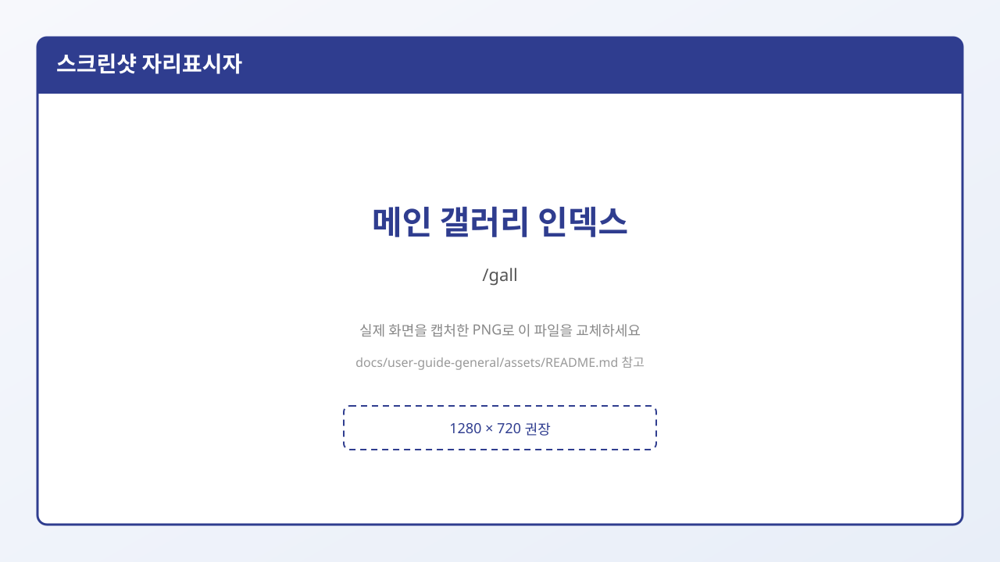
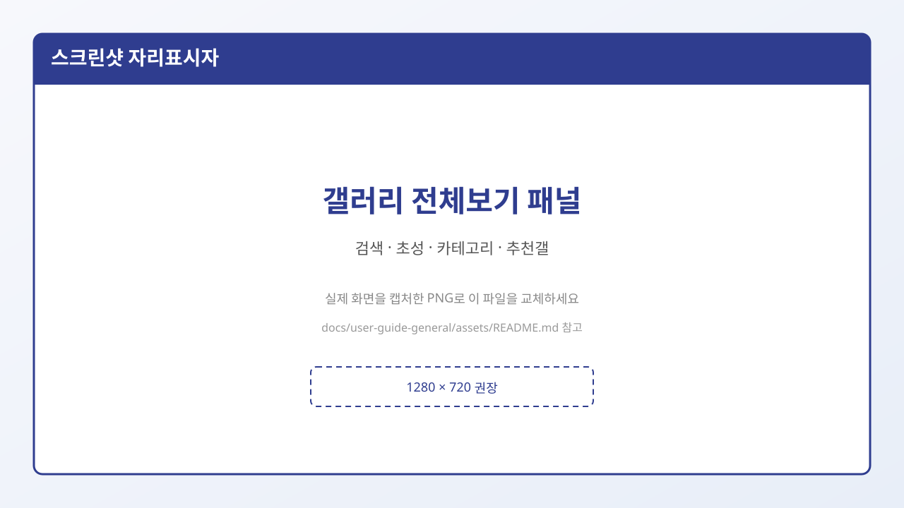

# 5. 갤러리 둘러보기 · 전체보기

## 종류별 인덱스(광장) 들어가기

헤더에서 **갤러리 / 마이너갤 / 미니갤 / 인물갤** 중 하나를 누릅니다.

각 인덱스에서는 대략 이런 일을 합니다.

- 흥한/추천 갤러리 둘러보기
- **갤러리 만들기** 버튼으로 개설 신청 화면 이동
- **갤러리 전체보기**로 이름·초성·카테고리로 찾기

---

## 갤러리 전체보기란?

주소가 따로 있는 페이지가 아니라, 인덱스에서 **「갤러리 전체보기」** 를 누르면 뜨는 **검색 패널(오버레이)** 입니다.

### 무엇이 보이나요?

| 영역 | 설명 |
|------|------|
| **갤러리 검색** | 이름으로 찾기 |
| **ㄱ~ㅎ / A-Z** | 초성·알파벳으로 좁히기 |
| **카테고리** | 주제 분류로 정렬·필터 |
| **검색결과** | 현재 메뉴(메인/마이너/미니/인물)에 맞는 갤만 보여 줌 |
| **추천갤러리** | 아래쪽에 추천 목록 |

### 이용자 팁

- **메인** 인덱스에서 전체보기를 열면 **메인 갤** 위주로 결과가 나옵니다.  
  마이너 인덱스에서는 **마이너** 위주입니다. (종류가 섞여 헷갈리지 않도록)
- 검색어를 비우고 초성·카테고리만 골라도 목록을 좁힐 수 있습니다.
- **Esc** 또는 바깥을 클릭하면 닫힙니다.

---

## 갤러리 안으로 들어가기

검색결과나 목록에서 갤러리 이름을 누르면 **게시판 목록**으로 이동합니다.

| 종류 | 목록 URL 예 |
|------|-------------|
| 메인 | `/gall/board/lists/?id=주소` |
| 마이너 | `/gall/mgallery/board/lists/?id=주소` |
| 미니 | `/gall/mini/board/lists/?id=주소` |
| 인물 | `/gall/p/board/lists/?id=주소` |

글을 열면 `view`, 쓰기는 `write` 경로를 사용합니다. 자세한 내용은 → [9. 글 읽기·쓰기](./09-글-읽기와-쓰기.md)

방문한 갤은 헤더 **최근 방문**에 쌓입니다. → [1. 화면 둘러보기](./01-화면-둘러보기.md)

## 다음에 읽을 글

→ [6. 검색](./06-검색.md)
