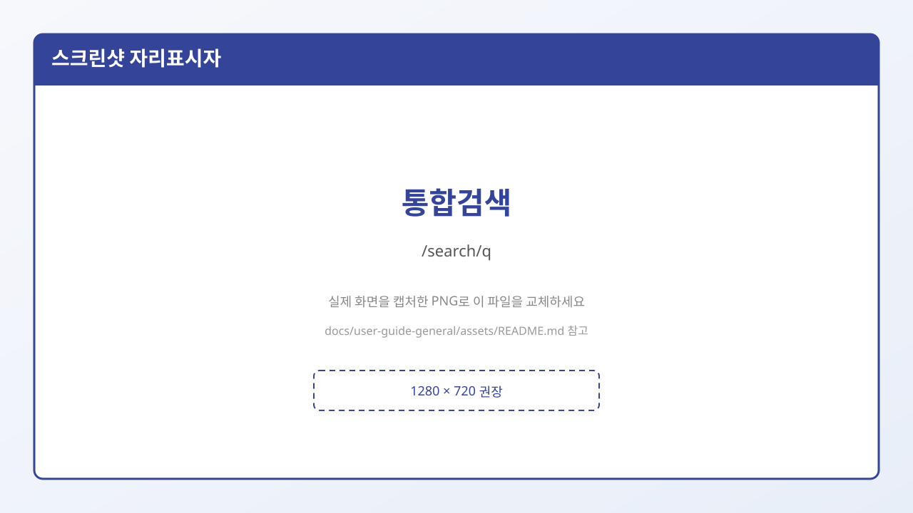

# 6. 검색

검색은 크게 두 가지입니다.

1. **헤더 통합검색** — 사이트 전체에서 찾기  
2. **갤러리 전체보기** — 지금 보고 있는 종류(메인/마이너/미니/인물) 안에서 갤러리 찾기  

---

## 1) 통합검색 (`/search/q`)

헤더 검색창에 키워드를 넣고 검색합니다.  
주소 예: `/search/q?keyword=축구`

### 탭(화면 기준)

| 탭 | 설명 |
|----|------|
| **갤러리** | 갤러리 **이름(제목)** 또는 **갤 ID(주소/slug)** 로 찾습니다 |
| **게시물** | 글 내용·제목 쪽 검색 |
| **동영상** | 「동영상 검색은 준비 중입니다.」 안내일 수 있음 |

> **초보 팁:** 갤러리를 찾을 때는 “정확한 이름” 또는 “주소(영문 ID)”를 넣는 것이 유리합니다.  
> 비슷한 한글 키워드만 넣으면 결과가 적을 수 있습니다.

결과에서 갤러리/글을 누르면 해당 게시판 목록 또는 본문으로 이동합니다.

---

## 2) 갤러리 전체보기 검색

인덱스 페이지의 **갤러리 전체보기** 버튼 → 패널에서 검색.

- 텍스트 검색 + 초성 + 카테고리를 **같이** 쓸 수 있습니다.
- 결과가 없으면 「검색 결과가 없습니다.」  
- 아직 아무것도 고르지 않으면 「검색어 또는 카테고리를 선택하세요.」

자세한 UI는 → [5. 갤러리 둘러보기](./05-갤러리-둘러보기.md)

---

## 어떤 검색을 써야 할까?

| 목적 | 추천 |
|------|------|
| “축구”라는 **글**도 찾고 싶다 | 통합검색 → 게시물 |
| **미니 갤**만 초성으로 훑고 싶다 | `/gall/n` → 전체보기 |
| 갤 **주소(ID)** 를 알고 있다 | 통합검색 갤러리 탭 또는 주소로 직접 이동 |
| 오늘 봤던 갤로 빨리 돌아가기 | 헤더 **최근 방문** (검색 아님) |

---

## 따라하기 동영상

- [assets/videos/03-search-allview.md](./assets/videos/03-search-allview.md)

## 다음에 읽을 글

→ [7. 새 갤러리 만들기](./07-새-갤러리-만들기.md)
