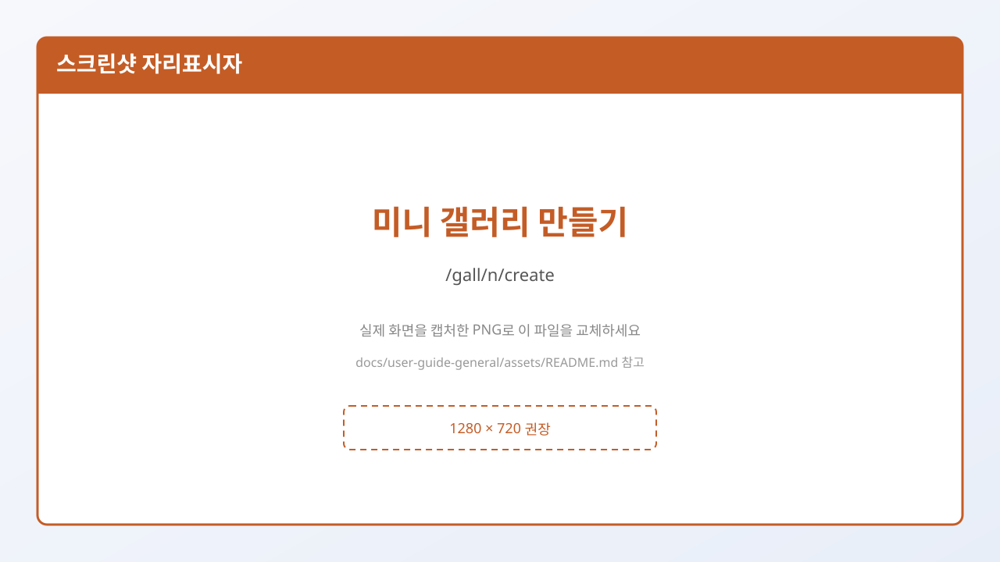

# 7. 새 갤러리 만들기

로그인한 뒤, 만들고 싶은 종류에 맞는 **만들기** 페이지로 갑니다.

| 종류 | 만들기 주소 |
|------|-------------|
| 메인 | `/gall/create` |
| 마이너 | `/gall/m/create` |
| 미니 | `/gall/n/create` |
| 인물 | `/gall/p/create` |

> **로그인 없이** 주소를 열면 로그인 화면으로 보내질 수 있습니다.

종류 고르는 법은 → [4. 갤러리 종류 비교](./04-갤러리-종류-비교.md)

---

## 공통으로 채우는 항목

| 항목 | 설명 | 실패하기 쉬운 점 |
|------|------|------------------|
| **이름** | 갤러리 이름 (최대 12자) | 비우면 「이름을(를) 입력해 주세요.」 |
| **설명** | 갤 소개 (최대 200자, 필수) | 비우면 「설명을 입력해 주세요.」 |
| **주소** | 영문 소문자 위주 URL 조각 (2~20자) | 한글/대문자 불가. `my-gall01` 형태 |
| **카테고리** | 목록에서 선택 | 미선택 시 「카테고리를 선택해 주세요.」 |
| **개설 이유** | 메인·마이너·인물에서 필수 | 미니는 화면에 없고 자동으로 채워짐 |
| **동의 체크** | 개인정보정책·운영원칙 등 | 체크 안 하면 진행 불가 |

**만들기**를 누르면:

1. 화면에서 먼저 위 규칙을 검사합니다.  
2. 문제가 있으면 **토스트 메시지**와 입력칸 아래 **빨간 안내**로 이유를 보여 줍니다.  
3. 통과하면 **개설 신청**이 접수됩니다.

성공 시 대략 이런 안내가 뜹니다.  
「○○ 갤러리 생성 요청이 완료되었습니다.」

> “요청이 완료” ≠ “이미 누구나 볼 수 있게 열림” 일 수 있습니다.  
> 심사가 있는 종류는 → [8. 개설 심사와 결과](./08-개설-심사와-결과.md)

---

## 미니 갤러리만의 추가 선택

`/gall/n/create` 상단:

| 선택 | 의미 |
|------|------|
| **공개** | 검색·열람이 비교적 자유로움 |
| **비공개** | 검색 노출이 제한되고, 가입 회원만 열람한다고 안내 |

- 만든 뒤에는 **공개↔비공개 변경 불가**라고 안내합니다.
- 주소 미리보기: `https://gall.dcinside.com/mini/` + 내가 입력한 주소
- 동의 문구도 「미니 갤러리 개인정보정책 / 운영원칙」으로 표시됩니다.
- 안내: 최대 6개, 마지막 개설 후 7일 뒤 추가 개설 가능

---

## 마이너 갤러리 신청 시 팝업

`/gall/m/create`에 처음 들어가면 **신청 시 유의 사항** 창이 뜰 수 있습니다.

- 중복 주제는 개설 불가  
- 미니 갤은 중복 주제 가능 → 링크 안내  
- 일부 마이너는 심사 후 메인 승격 가능, 승격 시 매니저 권한 회수  

꼭 읽고 **확인**한 뒤 작성하세요.

---

## 주소(영문 ID) 잘 정하는 법

| 좋은 예 | 나쁜 예 | 이유 |
|---------|---------|------|
| `football` | `축구` | 한글 주소 불가 |
| `k-pop01` | `K-POP` | 대문자 불가(소문자만) |
| `my_room` | `a` | 너무 짧음(2자 이상) |

주소는 **만든 뒤 수정이 어렵다**고 안내하므로, 신중히 정하세요.

---

## 따라하기 동영상

- [assets/videos/04-create-mini-and-approval.md](./assets/videos/04-create-mini-and-approval.md)

## 다음에 읽을 글

→ [8. 개설 심사와 결과](./08-개설-심사와-결과.md)
