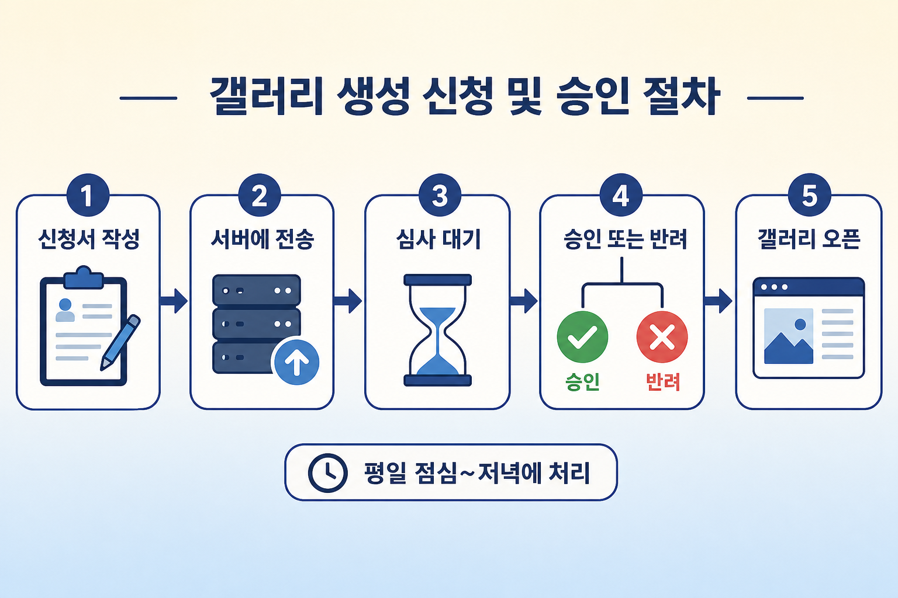
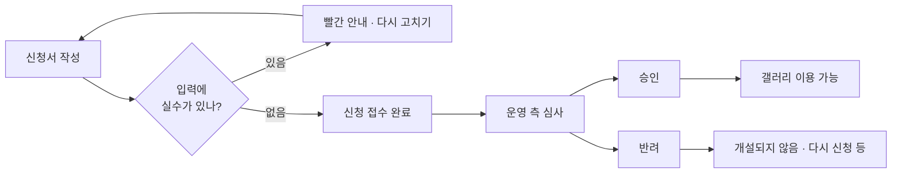
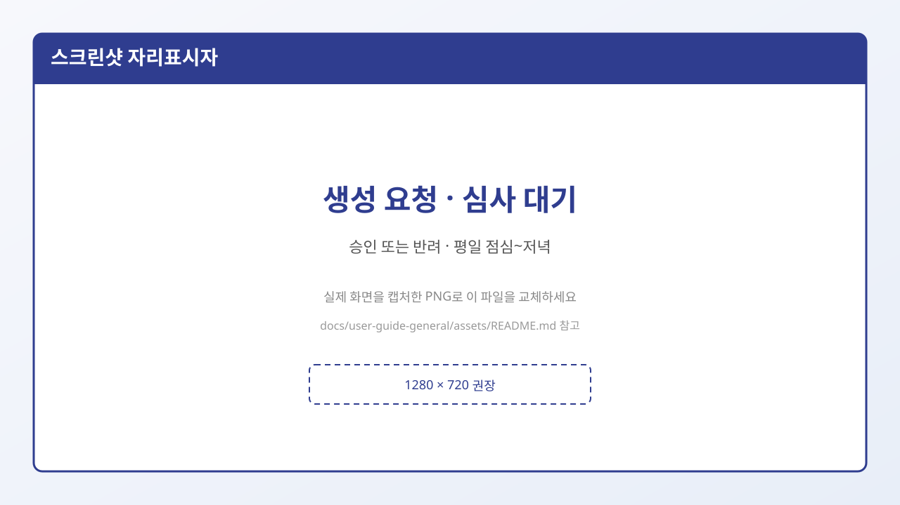

# 8. 개설 심사와 결과

초보자가 가장 궁금해하는 질문:

> 「만들기 버튼을 눌렀는데, 바로 갤러리가 생기나요? 누가 허가해 주나요?」

**이용자 눈에 보이는 일**만 정리합니다.

---

## 1) 신청 전에 화면에서 막히는 경우

만들기 버튼을 눌렀을 때 바로 빨간 안내가 뜨면, **심사가 거절된 것이 아닙니다.**  
아직 신청서가 비었거나 규칙에 안 맞는 상태입니다.

예:

- 이름을 안 씀  
- 주소에 한글을 씀  
- 카테고리를 안 고름  
- 동의 체크를 안 함  

메시지를 읽고 고친 뒤, 다시 **만들기**를 누르면 됩니다.

---

## 2) 「생성 요청이 완료되었습니다」

입력에 문제가 없으면, 보통 이런 안내가 뜹니다.

> 「○○ 갤러리 **생성 요청**이 완료되었습니다.」

여기서 중요한 점:

- **요청이 접수**되었다는 뜻에 가깝습니다.  
- 종류에 따라 **곧바로 누구나 쓸 수 있게 열리는 것**과 다를 수 있습니다.  
- 메인·마이너·인물 등은 화면 안내에 **심사 후 개설**, **승인 또는 반려**라는 문구가 있습니다.

---

## 3) 심사는 누가, 언제 하나요?

이용자가 “승인하기” 버튼을 누르는 화면은 **없습니다.**  
운영·심사 쪽에서 신청 내용을 보고 처리합니다.

화면에 자주 나오는 안내 (요약):

| 안내 문구 | 이렇게 이해하면 됩니다 |
|-----------|------------------------|
| 심사 후 개설이 확정됩니다 | 바로 안 열릴 수 있음 |
| 이름·설명·주소·개설 이유에 따라 승인 또는 반려 | 적은 내용이 중요함 |
| 승인·반려는 **평일 점심~저녁**에 처리 | 주말·심야는 결과가 늦을 수 있음 |
| 기준에 안 맞으면 반려될 수 있음 | 주제를 바꿔 다시 신청할 수 있음 |

### 마이너일 때 특히

- **비슷한 주제** 갤이 이미 있으면 반려될 수 있음 → 신청 전 검색 필수  
- 일부 주제는 나중에 **메인 갤러리로 승격**될 수 있고, 승격 시 매니저 권한이 없어질 수 있음  

### 미니일 때

- 메인으로 승격되지 않는다고 안내  
- 최대 6개, 마지막 개설 후 **7일** 뒤에 또 만들 수 있다고 안내  
- **공개/비공개**는 만든 뒤 바꾸기 어렵다고 안내하므로 처음에 신중히

---

## 승인 / 반려 / 대기 — 결과로 체감하는 것

| 결과 | 이용자가 느끼는 것 |
|------|-------------------|
| **승인** | 목록·검색·주소로 갤이 열려 글을 읽고 쓸 수 있음 |
| **반려** | 갤이 안 생기거나 쓸 수 없음. 이유(중복 주제 등)를 안내받을 수 있음 |
| **대기** | 신청은 됐는데 아직 목록에 안 보일 수 있음 |

---

## 신청 전 체크리스트

- [ ] 비슷한 갤이 이미 있는지 **검색**했는가? (특히 마이너)
- [ ] 이름·설명이 운영원칙에 위배되지 않는가?
- [ ] 주소(영문)를 신중히 정했는가? (나중에 수정이 어려움)
- [ ] 미니라면 공개/비공개를 결정했는가?
- [ ] 필수 동의에 모두 체크했는가?
- [ ] 신청 직후 안 보여도 **심사 대기**일 수 있음을 아는가?

## 다음에 읽을 글

→ [9. 글 읽기·쓰기](./09-글-읽기와-쓰기.md)
