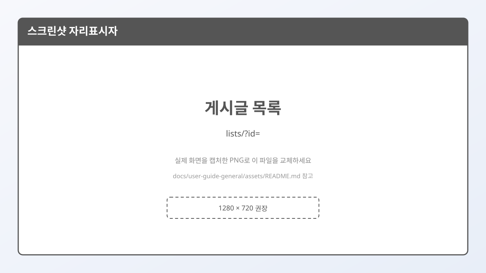
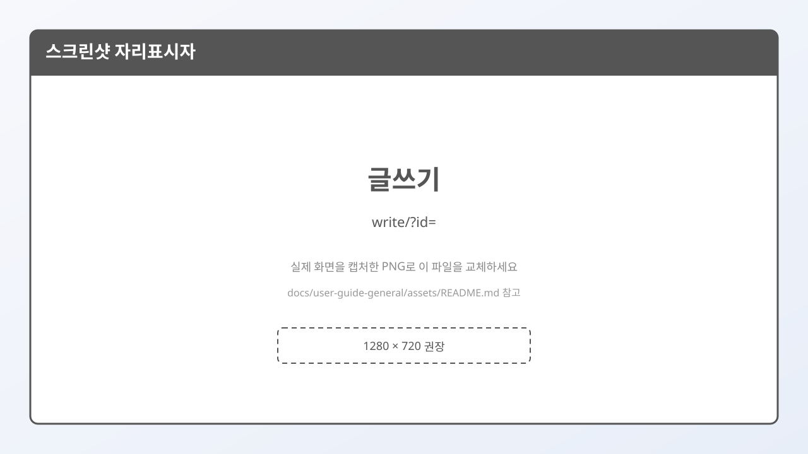

# 9. 글 읽기·쓰기

## 글 목록

갤러리에 들어가면 **게시글 목록**이 보입니다.  
주소에 `lists`와 `?id=갤주소`가 붙어 있습니다.

| 종류 | 목록 경로 예 |
|------|----------------|
| 메인 | `/gall/board/lists/?id=...` |
| 마이너 | `/gall/mgallery/board/lists/?id=...` |
| 미니 | `/gall/mini/board/lists/?id=...` |
| 인물 | `/gall/p/board/lists/?id=...` |

목록에서 제목을 누르면 **글 보기(`view`)** 로 이동합니다. (`no` = 글 번호)

---

## 글 보기

본문, 작성자, 댓글 등을 확인합니다.

---

## 글쓰기

목록/보기 화면의 **글쓰기**로 이동합니다. (`write`)

- 로그인이 필요할 수 있습니다.
- 제목과 본문을 작성한 뒤 등록합니다.
- 에디터에서 본문을 입력할 때, 커서가 이상하게 맨 앞으로 튀면 새로고침 후 다시 시도해 보세요. (개선된 편집기를 쓰는 경우도 있습니다.)

> **비공개 미니 갤**에서는 권한이 없는 이용자는 글이 안 보이거나 쓰기가 막힐 수 있습니다.

---

## 다음에 읽을 글

→ [10. 주의사항과 FAQ](./10-주의사항과-FAQ.md)
